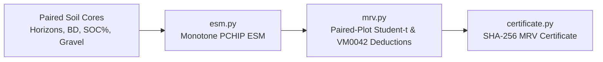

# soilcarbon-mrv

[](https://github.com/codesphere-u/soilcarbon-mrv/actions/workflows/ci.yml)
[](LICENSE)
[](pyproject.toml)
[](pyproject.toml)

**Zero-dependency Equivalent Soil Mass (ESM) soil organic carbon stock, Verra VM0042 uncertainty deduction, permanence buffer pool, and SHA-256 tamper-evident MRV certificate engine.**

- **Mission Domain:** Climate Tech & Regenerative Agriculture MRV
- **Stack:** Pure Python 3.11+ (zero runtime third-party dependencies, `mypy --strict`, `ruff`, `pytest`)
- **Maintainer:** Codesphere Innovations (U) Limited (`codesphere-u`)

---

## Problem Solved

Naive fixed-depth (0–30 cm) soil carbon accounting systematically creates phantom carbon credits whenever tillage or compaction changes bulk density, invalidating regenerative agriculture MRV claims.

## Key Features

- Rock-fragment-corrected fine-earth mass and monotone cubic Hermite (PCHIP) Equivalent Soil Mass (ESM) interpolation (`compute_esm_stock`, `compare_fixed_depth_vs_esm`).
- Paired-plot stratum uncertainty analysis with Student's t 90% two-tailed / 95% one-sided confidence bounds and Verra VM0042-style excess-uncertainty, leakage, and permanence buffer deductions (`evaluate_stratum_mrv`).
- Deterministic SHA-256 tamper-evident MRV issuance certificates (`issue_certificate`, `verify_certificate`).

## Architecture Overview



See [docs/architecture.md](docs/architecture.md) for module-level design details.

## Installation

```bash
git clone https://github.com/codesphere-u/soilcarbon-mrv.git
cd soilcarbon-mrv
uv sync --extra dev
```

Or install in editable mode with standard `pip`:

```bash
pip install -e ".[dev]"
```

## Quick Start (CLI)

```bash
soilcarbon-mrv stratum.json --target-depth-cm 30 --buffer-pct 20
```

## Quick Start (Python API)

```python
from soilcarbon_mrv import HorizonSample, SoilCore, compare_fixed_depth_vs_esm

base = SoilCore('B1', (HorizonSample(0, 15, 1.20, 2.0), HorizonSample(15, 30, 1.20, 2.0)))
comp = SoilCore('M1', (HorizonSample(0, 15, 1.35, 2.0), HorizonSample(15, 30, 1.35, 2.0)))
cmp = compare_fixed_depth_vs_esm(base, comp, target_depth_cm=30.0)
assert abs(cmp.delta_esm_mg_c_ha) < 1e-3 and cmp.phantom_fd_bias_tco2e_ha > 30.0
```

## Testing & Quality Gates

```bash
uv run ruff check src tests
uv run mypy src
uv run pytest -v
```

## Security, Contributing & Roadmap

- **Security:** See [SECURITY.md](SECURITY.md) for responsible disclosure procedures.
- **Contributing:** See [CONTRIBUTING.md](CONTRIBUTING.md) and [CODE_OF_CONDUCT.md](CODE_OF_CONDUCT.md).
- **Changelog & Roadmap:** See [CHANGELOG.md](CHANGELOG.md) and [ROADMAP.md](ROADMAP.md).

## License

MIT License — see [LICENSE](LICENSE).

## Support & Contact

Open an issue on [GitHub Issues](https://github.com/codesphere-u/soilcarbon-mrv/issues) or contact `codesphereinnovationz@gmail.com`.
